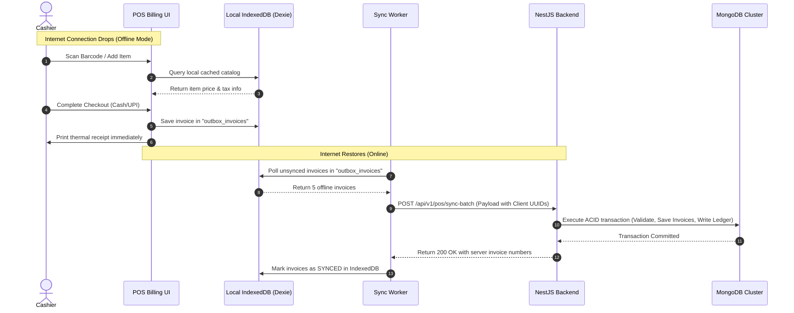

# 🏗️ Vendora – System Architecture & Technical Design

> **Product**: Vendora – Cloud-Based Multi-Tenant Retail POS & ERP SaaS  
> **Tech Stack**: React + TypeScript + Vite + Tailwind CSS + React Router DOM | NestJS + TypeScript | MongoDB (Mongoose) + Redis

---

> **Implementation status (Nov 2026).** This document describes the target architecture. What is built today:
> - **Built:** NestJS modular monolith with MongoDB/Mongoose; global JWT guard (access + rotating refresh tokens, separate secrets); tenant taken from the token via `@TenantId()` and explicit `tenantId` filters in every query; platform super-admin guard; atomic per-tenant document counters (`counters` collection) for INV/RET/SHIFT/GRN numbers; MongoDB transactions for billing, returns and GRNs when running on a replica set.
> - **Frontends:** plain React state + hooks (no Zustand / TanStack Query yet), a shared axios instance with token refresh in `client/src/lib/api.ts`, no router in the POS client.
> - **Not built yet:** Redis, BullMQ workers, object storage, the Mongoose tenancy plugin / AsyncLocalStorage tenant context, subdomain routing, offline IndexedDB sync, service worker, ESC/POS bridge, weighing-scale integration.

## 1. High-Level System Architecture

Vendora employs a modern, multi-tier, multi-tenant SaaS architecture designed for sub-second billing latency, carrier-grade data isolation, and resilient offline capabilities.

```mermaid
flowchart TD
    subgraph ClientLayer ["Client Layer (Web / POS Terminal)"]
        UI["React 19 + Vite + TypeScript"]
        TW["Tailwind CSS UI Component Library"]
        RR["React Router DOM v6"]
        TQ["TanStack Query (Cache & Remote State)"]
        ZU["Zustand (POS Cart & Session State)"]
        IDB["IndexedDB / Dexie.js (Offline Store)"]
        SW["Service Worker (Asset & API Cache)"]
    end

    subgraph GatewayLayer ["Ingress & Security"]
        NGINX["Reverse Proxy / Cloudflare Edge"]
        SSL["TLS 1.3 Termination"]
        SUB["Subdomain Router (*.vendora.com)"]
    end

    subgraph BackendLayer ["Application Tier (NestJS Modular Monolith)"]
        APP["NestJS Application Core"]
        GUARD["Tenant & JWT RBAC Guards"]
        AUTH_MOD["Auth & Onboarding Module"]
        POS_MOD["POS Billing Engine"]
        INV_MOD["Stock Ledger & Inventory Module"]
        PUR_MOD["Procurement & Suppliers Module"]
        ACC_MOD["Accounting & Finance Module"]
        REP_MOD["Reports & Analytics Aggregator"]
        QUEUE["BullMQ Background Workers"]
    end

    subgraph StorageLayer ["Persistence & Cache Layer"]
        MONGO[("MongoDB Cluster (Replica Set)")]
        REDIS[("Redis (Tokens, Caching, BullMQ)")]
        S3[("Object Storage (Invoices, Receipts, Images)")]
    end

    ClientLayer <-->|HTTPS / REST / WebSocket| GatewayLayer
    GatewayLayer <--> BackendLayer
    BackendLayer <--> StorageLayer
```



---

## 2. Multi-Tenancy Strategy

Vendora utilizes the **Shared Database, Discriminator Multi-Tenancy Model** backed by MongoDB. This approach ensures maximum resource efficiency, cost predictability for high tenant counts, and automated schema migrations while maintaining enterprise-level data segregation.

### Tenancy Principles:
1. **Mandatory Tenant Scoping**: Every store document in MongoDB (Products, Invoices, Stock Ledger, Customers) contains an immutable `tenantId: ObjectId` reference.
2. **Subdomain Resolution**:
   - Each merchant is allocated a dedicated shop subdomain: `https://<shopId>.vendora.com`.
   - The NestJS `TenantInterceptor` extracts the subdomain from the `Host` header or `X-Tenant-ID` header.
3. **Compound Tenant Indexing**: Every business collection creates compound indexes starting with `tenantId`:
   ```javascript
   // Example Product compound index:
   productSchema.index({ tenantId: 1, barcode: 1 }, { unique: true });
   productSchema.index({ tenantId: 1, name: "text" });
   ```
4. **Mongoose Tenancy Plugin**: An automated Mongoose pre-hook automatically injects `tenantId` into `find`, `findOne`, `countDocuments`, `update`, and `delete` operations:
   ```typescript
   schema.pre(/^find/, function (next) {
     const tenantId = TenantContext.getTenantId();
     if (tenantId) {
       this.where({ tenantId });
     }
     next();
   });
   ```

---

## 3. Backend Architecture (NestJS)

The backend is built as a clean, modular monolith structured around Domain-Driven Design (DDD) principles.

```
apps/api/src/
├── app.module.ts
├── common/
│   ├── decorators/         # @Tenant(), @CurrentUser(), @Permissions()
│   ├── guards/             # JwtAuthGuard, TenantGuard, RolesGuard
│   ├── interceptors/       # TransformInterceptor, TenantContextInterceptor
│   ├── filters/            # GlobalExceptionFilter
│   ├── middleware/         # SubdomainTenantMiddleware
│   └── utils/              # Crypto, date helpers, number series generator
├── modules/
│   ├── tenant/             # Tenant provisioning & lifecycle
│   ├── auth/               # Multi-tenant JWT auth, sessions, OTP
│   ├── onboarding/         # SaaS plan selection, registration pipeline
│   ├── business/           # Settings, outlets, units, tax config
│   ├── product/            # Catalog, variants, barcodes, pricing
│   ├── inventory/          # Double-entry stock ledger, movements, audits
│   ├── pos/                # Ultra-fast billing counter, hold/recall, cart
│   ├── purchase/           # Suppliers, POs, GRN, purchase invoices
│   ├── customer/           # Customer profiles, credit (Khata), statements
│   ├── sales/              # Quotations, returns, refunds, deliveries
│   ├── accounting/         # COA, day book, cash book, journal entries
│   ├── reports/            # Aggregations, GSTR-1, P&L, dashboard metrics
│   ├── offline-sync/       # Background sync queue & conflict resolver
│   ├── saas-admin/         # Super admin console, usage metering, plans
│   └── notification/       # Email (Nodemailer/Resend) & WhatsApp hooks
└── database/
    ├── mongoose-config.service.ts
    └── plugins/tenant.plugin.ts
```

### Layered Processing Pipeline:
1. **Controllers**: Pure REST endpoints declaring routes, Swagger documentation, and DTO validations via `class-validator`.
2. **Guards & Interceptors**: Validate JWT signature, check tenant context, enforce RBAC permissions, and attach `TenantContext` to the AsyncLocalStorage thread.
3. **Services**: Business logic orchestration, calculation of GST, validation of business rules.
4. **Mongoose Repositories**: Encapsulate MongoDB queries, transactions, and aggregation pipelines.
5. **Background Queues (BullMQ)**: Asynchronous processing of transactional emails, bulk CSV imports, PDF invoice rendering, and nightly accounting rollups.

---

## 4. Frontend Architecture (React + Vite + TypeScript)

The frontend is a single-page application (SPA) optimized for counter speed, responsiveness, and minimal latency.

```
apps/web/src/
├── main.tsx
├── App.tsx
├── routes/                 # React Router DOM routes configuration
│   ├── PublicRoutes.tsx    # Landing, Plans, Registration, Verify OTP
│   ├── AuthRoutes.tsx      # Login, Forgot Password, First Login Reset
│   ├── AppRoutes.tsx       # Back-office ERP (Products, Inventory, Reports)
│   └── PosRoutes.tsx       # Dedicated Fullscreen POS Billing Terminal
├── layouts/
│   ├── PublicLayout.tsx
│   ├── DashboardLayout.tsx
│   └── PosLayout.tsx       # Minimalist, distraction-free checkout layout
├── components/
│   ├── ui/                 # Reusable Tailwind atoms (Button, Modal, Input, Badge)
│   ├── pos/                # BarcodeListener, CartTable, TenderModal, QuickKeypad
│   ├── forms/              # Controlled form fields with React Hook Form
│   └── shared/             # DataTable, DateRangePicker, ExportButtons
├── hooks/
│   ├── useTenant.ts        # Subdomain / tenant context hook
│   ├── useBarcode.ts       # Global keyboard HID barcode scanner listener
│   ├── usePosCart.ts       # POS cart state and calculations
│   └── useHotkeys.ts       # F1-F12 counter keyboard shortcut dispatcher
├── services/
│   ├── api.ts              # Axios instance with auth & tenant headers
│   ├── offlineStorage.ts   # Dexie.js / IndexedDB wrapper
│   └── printService.ts     # ESC/POS thermal printer generator
└── stores/
    ├── authStore.ts        # Zustand auth token & user state
    └── posStore.ts         # Zustand active bill, held carts state
```

### Key Frontend Architectural Innovations:
- **Zero-Latency Keyboard Operation**: The POS counter implements a unified `useHotkeys` and `useBarcode` hook that intercepts raw HID keyboard wedge events from handheld laser scanners without requiring focus on a specific input box.
- **Micro-State Management**: Zustand handles high-frequency in-memory cart changes (item additions, quantity increments) to prevent unnecessary re-rendering of surrounding layouts.
- **Server Cache & Invalidation**: TanStack Query manages asynchronous server state with stale-while-revalidate caching.

---

## 5. Offline-First POS & Background Synchronization Architecture

Retailers cannot stop billing when internet connectivity drops. Vendora implements an **Offline-First Synchronization Architecture**.



### Conflict Resolution Strategy:
1. **Client Invoice UUID**: Every offline invoice is assigned an immutable `clientInvoiceId` (UUIDv4) upon creation.
2. **Sequential Server Numbering**: Upon synchronization, the server assigns the official, consecutive legal invoice number (`INV-2026-XXXX`).
3. **Inventory Reconciler**: When an offline bill syncs, stock ledger debits are recorded against the timestamp of the sale. If stock drops below zero, a `NEGATIVE_STOCK_WARNING` event is flagged in the audit log without halting business operations.

---

## 6. Hardware Integration Layer

Vendora connects directly to standard point-of-sale hardware without requiring third-party drivers:

1. **Barcode Scanners (Laser / 2D QR)**:
   - Handheld USB and Bluetooth scanners operate as Human Interface Devices (HID Keyboard Wedge).
   - Vendora listens to rapid keyboard streams terminated by an `Enter` character (>30 chars in <50ms) to distinguish scanner input from human typing.
2. **Thermal Receipt Printers (58mm / 80mm)**:
   - **Direct Browser Print Mode**: Pure CSS `@media print` rules formatted to 58mm (2-inch) and 80mm (3-inch) widths with auto-cut commands.
   - **ESC/POS Helper Bridge**: Optional lightweight WebSocket agent listening on `localhost:9100` that sends raw binary ESC/POS commands directly to USB/Ethernet thermal printers, bypassing browser print dialogs.
3. **Electronic Weighing Scales**:
   - Web Serial API (`navigator.serial`) reads continuous live tare and gross weight strings from RS-232 / USB scale connections.

---

## 7. Security, Compliance & Data Protection

- **Tenant Isolation Safeguards**: Automated automated unit and e2e tests ensure no query can leak data across tenant boundaries.
- **Authentication**: JWT access tokens (15m expiry) signed with RS256/HS256, paired with cryptographically random HTTP-only refresh tokens.
- **Data Protection at Rest & Transit**: TLS 1.3 encryption across all network ingress; sensitive merchant settings (API keys, bank details) encrypted in MongoDB using AES-256-GCM.
- **Role-Based Access Control (RBAC)**: Fine-grained permissions allowing owners to restrict cashiers from viewing purchase costs, profit margins, or historical sales reports.

---

*Vendora System Architecture – Approved for Production Implementation.*

