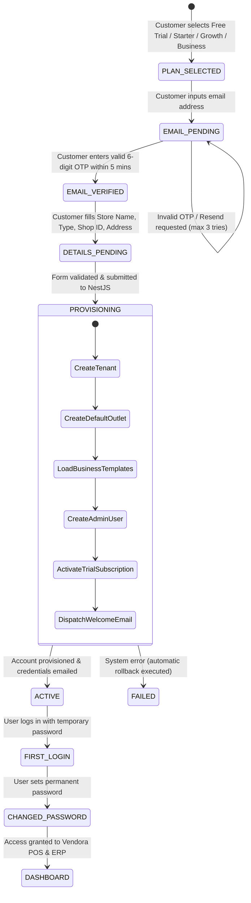

# 🚀 Vendora – Self-Service SaaS Registration & Onboarding Workflow

> **Product**: Vendora – Cloud-Based Multi-Tenant Retail POS & ERP SaaS  
> **Workflow Pattern**: Plan Selection ➔ Email OTP Verification ➔ Business Details ➔ Auto-Provisioning ➔ Credential Email ➔ First-Login Password Change

---

## 1. End-to-End Onboarding Architecture & State Machine



---

## 2. Step-by-Step Customer Journey

### 📍 Step 1: Plan Selection
The customer visits `https://vendora.com/pricing` or clicks **"Start Free Trial"** on the landing page.
- Available options:
  - **30-Day Free Trial** (₹0 / 30 Days – up to 1,000 bills, 1 outlet, 1 user)
  - **Starter** (₹999/month – up to 10,000 bills, 1 outlet, 1 user)
  - **Growth** (₹1,799/month – up to 30,000 bills, 1 outlet, 5 users)
  - **Business** (₹3,499/month – up to 60,000 bills, 2 outlets, 8 users)
- Choosing a plan stores `selectedPlanCode` in the registration session state.

---

### 📍 Step 2: Email OTP Verification
To eliminate bots and ensure deliverability of credentials, the merchant verifies their email **first**.

1. Merchant enters `owner@example.com`.
2. Frontend calls `POST /api/v1/onboarding/request-email-otp`.
3. Backend generates a cryptographically secure 6-digit integer OTP (using `crypto.randomInt(100000, 999999)`).
4. The OTP is hashed with bcrypt and saved with a 5-minute TTL in the `registration_sessions` collection.
5. Merchant receives an immediate verification email:

```
Subject: Verify your email – Vendora Cloud Retail POS

Hello,

Thank you for choosing Vendora!

Your email verification OTP code is:

      ┌──────────┐
      │  849 201 │
      └──────────┘

This OTP is valid for 5 minutes. Please do not share this code with anyone.

Regards,
Vendora Provisioning Team
```

6. Merchant enters the 6-digit code on the UI.
7. Frontend calls `POST /api/v1/onboarding/verify-email-otp`.
8. On success, the session updates to `status = 'EMAIL_VERIFIED'`.

---

### 📍 Step 3: Business Details & Subdomain Selection
Once email ownership is verified, the merchant completes their business profile:

| Form Field | Type | Validation Rules | Description |
| :--- | :--- | :--- | :--- |
| **Business / Shop Name** | Text | Required, 3–80 chars | e.g., *Sri Murugan Supermarket* |
| **Owner Full Name** | Text | Required, 2–60 chars | e.g., *Pandi Selvam* |
| **Contact Mobile** | Phone | Required, +91 10 digits | e.g., `+91 98765 43210` |
| **Business Type** | Select | Enum (Grocery, Garments, etc.) | Determines starter catalog & units |
| **Preferred Shop ID** | Text | Slug: lowercase, a-z, 0-9, hyphens | Subdomain identifier (e.g., `srimurugan`) |
| **Store Address** | Text | Street, City, State, Pincode | Physical store location |
| **GSTIN** | Text | Optional, Valid 15-char regex | Goods & Services Tax Identification No. |

#### Real-Time Subdomain Availability Check:
As the user types their `preferredShopId`, the client debounces a check to:
`GET /api/v1/onboarding/check-subdomain?shopId=srimurugan`
- Returns: `{ available: true, fullUrl: "https://srimurugan.vendora.com" }`

---

### 📍 Step 4: Transactional Provisioning Pipeline (Backend)

When the merchant clicks **"Create My Account"**, `POST /api/v1/onboarding/complete-registration` executes inside a **MongoDB Transaction Session**:

```typescript
// NestJS Provisioning Pipeline Service
async provisionTenant(sessionDto: CompleteRegistrationDto) {
  const session = await this.connection.startSession();
  session.startTransaction();

  try {
    // 1. Create Tenant Document
    const tenant = await this.tenantModel.create([{
      shopId: sessionDto.preferredShopId,
      businessName: sessionDto.businessName,
      ownerName: sessionDto.ownerName,
      email: sessionDto.email,
      phone: sessionDto.phone,
      businessType: sessionDto.businessType,
      status: 'ACTIVE'
    }], { session });

    // 2. Create Default Primary Outlet (Main Branch)
    const outlet = await this.outletModel.create([{
      tenantId: tenant[0]._id,
      name: 'Main Branch',
      code: 'OUT-01',
      address: sessionDto.address,
      phone: sessionDto.phone,
      isPrimary: true
    }], { session });

    // 3. Seed Industry Default Master Data (Categories, Units, Tax)
    await this.templateService.seedDefaultsForBusinessType(
      tenant[0]._id, 
      sessionDto.businessType, 
      session
    );

    // 4. Initialize Sequential Number Series
    await this.numberSeriesModel.create([
      { tenantId: tenant[0]._id, seriesType: 'INVOICE', prefix: 'INV', currentNumber: 1000 },
      { tenantId: tenant[0]._id, seriesType: 'GRN', prefix: 'GRN', currentNumber: 100 }
    ], { session });

    // 5. Generate High-Entropy Temporary Password
    const tempPassword = crypto.randomBytes(6).toString('base64url'); // e.g. "xK9#mQ2v"
    const passwordHash = await bcrypt.hash(tempPassword, 12);
    const username = `${sessionDto.preferredShopId}_admin`;

    // 6. Create Super Admin User
    await this.userModel.create([{
      tenantId: tenant[0]._id,
      outletIds: [outlet[0]._id],
      username: username,
      email: sessionDto.email,
      fullName: sessionDto.ownerName,
      passwordHash: passwordHash,
      role: 'OWNER',
      isTemporaryPassword: true,
      isActive: true
    }], { session });

    // 7. Activate 30-Day Free Trial Subscription
    await this.subscriptionModel.create([{
      tenantId: tenant[0]._id,
      planCode: sessionDto.selectedPlanCode,
      status: 'TRIAL',
      startsAt: new Date(),
      expiresAt: new Date(Date.now() + 30 * 24 * 60 * 60 * 1000), // +30 days
      billsGeneratedThisMonth: 0
    }], { session });

    await session.commitTransaction();

    // 8. Dispatch Welcome Email Asynchronously (BullMQ Job)
    await this.emailQueue.add('send-welcome-credentials', {
      to: sessionDto.email,
      businessName: sessionDto.businessName,
      shopUrl: `https://${sessionDto.preferredShopId}.vendora.com`,
      username: username,
      temporaryPassword: tempPassword
    });

    return { success: true, shopUrl: `https://${sessionDto.preferredShopId}.vendora.com` };
  } catch (error) {
    await session.abortTransaction();
    throw new InternalServerErrorException('Tenant provisioning failed. Rolled back.');
  } finally {
    session.endSession();
  }
}
```

---

### 📍 Step 5: Welcome Email with Login Credentials
The merchant receives their system-generated login credentials immediately:

```
From: Vendora Cloud Team <accounts@vendora.com>
Subject: Your Vendora Cloud POS account is ready! 🚀

Hello Pandi Selvam,

Welcome to Vendora! Your business workspace has been successfully created.

Here are your account credentials to start billing:

━━━━━━━━━━━━━━━━━━━━━━━━━━━━━━━━━━━━━━━━━━━━━━━━━
🏪 Shop Name:       Sri Murugan Supermarket
🔗 Your Login URL:  https://srimurugan.vendora.com
👤 Username:        srimurugan_admin
🔑 Temporary Pass:  xK9#mQ2v
━━━━━━━━━━━━━━━━━━━━━━━━━━━━━━━━━━━━━━━━━━━━━━━━━

⚠️ Security Notice:
For your store's security, you will be required to choose a new permanent 
password immediately upon your first login.

Getting Started Guide:
1. Open your shop URL in Google Chrome.
2. Sign in with the username and temporary password above.
3. Set your secure permanent password.
4. Follow the 3-minute guided setup to make your first bill!

Need support? Call us at +91 044-42142140 or reply to this email.

Best regards,
The Vendora Team
```

---

### 📍 Step 6: First-Login & Forced Password Rotation

1. Merchant navigates to their shop address: `https://srimurugan.vendora.com/login`.
2. Merchant enters:
   - Username: `srimurugan_admin`
   - Password: `[Temporary Password from Email]`
3. The NestJS backend `AuthService.login()` validates the password and checks `user.isTemporaryPassword === true`.
4. The server returns a JWT with restricted scope (`SCOPE: 'PASSWORD_RESET_ONLY'`).
5. The React client intercepts this response and redirects the user to:  
   `/auth/first-login-change-password`
6. The user enters a new permanent password (enforcing minimum 8 characters, uppercase, lowercase, number, symbol).
7. Backend updates `passwordHash`, sets `isTemporaryPassword: false`, issues a full-access JWT, and redirects user to `/dashboard`.

---

### 📍 Step 7: Post-Onboarding Guided Setup Checklist
Upon first arrival at the main dashboard, the merchant sees an interactive 4-step progress widget:

```
[=======>                        ] 25% Setup Complete
✅ 1. Store Profile & Tax Info verified
⬜ 2. Review preloaded Grocery items or add your first product
⬜ 3. Connect receipt printer or set billing preferences
⬜ 4. Ring up your first sample bill in the POS Counter
```

---

*Vendora Onboarding Flow – Production Specification Approved.*

