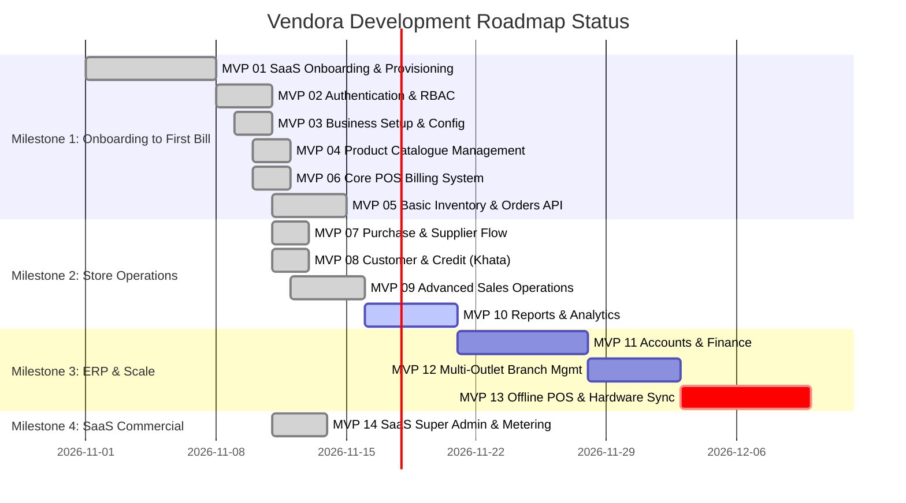

# 🗺️ Vendora – Complete MVP-Wise Development Roadmap

> **Product**: Vendora – Cloud-Based Multi-Tenant Retail POS & ERP SaaS  
> **Tagline**: *One platform. Every retail operation.*  
> **Tech Stack**: React + TypeScript + Vite + Tailwind CSS | NestJS 11 + Mongoose 8 + Nodemailer | MongoDB Multi-Tenant  
> **Architecture Ports**:
> - `landing/`: **Port `4000`** (Marketing site, pricing, `/register` onboarding, `/admin` Super Admin console)
> - `client/`: **Port `4001`** (Merchant Store POS Terminal & Cashier counter)
> - `server/`: **Port `5000`** (NestJS REST API `/api/v1` & Swagger `/docs`)

---

## 📌 Executive Summary

Vendora is engineered as an enterprise-grade, multi-tenant Cloud Retail POS and ERP SaaS designed for **15 retail sectors** (Textile & Garments, Supermarket, Grocery/Kirana, Pharmacy/Medical, Bakery & Sweets, Restaurant/Café, Electronics, Footwear, Jewellery, etc.).

Vendora follows an iterative **14-phase MVP roadmap**. Each release delivers an independently deployable, production-ready operational subsystem.

```
       [MILESTONE 1: ONBOARDING TO FIRST BILL]
MVP 01 (DONE) ──► MVP 02 (DONE) ──► MVP 03 (DONE) ──► MVP 04 (DONE) ──► MVP 05 (DONE) ──► MVP 06 (DONE)
                                                                                             │
       [MILESTONE 2: COMPLETE STORE OPERATIONS]                                               ▼
MVP 10 (UPCOMING) ◄── MVP 09 (NEXT PRIORITY) ◄── MVP 08 (DONE) ◄── MVP 07 (DONE) ◄─────────┘
  │
  ▼    [MILESTONE 3: ERP & MULTI-BRANCH SCALE]
MVP 11 ──► MVP 12 ──► MVP 13
                        │
                        ▼ [MILESTONE 4: COMMERCIAL SAAS PLATFORM]
                      MVP 14 (DONE - Super Admin Executive Console & Metering)
```

---

## 📊 Complete MVP Release Matrix

| Release | MVP Codename | Main Focus & Key Deliverable | Modules Count | Status | Port Scope |
| :--- | :--- | :--- | :---: | :---: | :--- |
| **MVP 01** | **SaaS Onboarding & Provisioning** | Plan selection, Gmail SMTP OTP, Auto-tenant provisioning, Welcome email | 15 Modules | ✅ **COMPLETED** | Port `4000` & `5000` |
| **MVP 02** | **Authentication & RBAC** | Multi-tenant auth, Refresh tokens, Roles, Granular permissions, Password change | 14 Modules | ✅ **COMPLETED** | Port `4001` & `5000` |
| **MVP 03** | **Business Setup & Config** | Shop profile, Outlets, Categories, GST rules, Number series, 15 Sector defaults | 14 Modules | ✅ **COMPLETED** | Port `4000`, `4001`, `5000` |
| **MVP 04** | **Product Catalogue Management** | Multi-tenant Catalog, Barcodes, MRP/Selling price, Sector starter seeder | 15 Modules | ✅ **COMPLETED** | Port `4001` & `5000` |
| **MVP 05** | **Basic Inventory & Stock Ledger** | Double-entry stock ledger, Stock IN/OUT, Real-time deduction on orders | 12 Modules | ✅ **COMPLETED** | Port `4001` & `5000` |
| **MVP 06** | **Core POS Billing System** | Billing counter, Fast barcode search, Cash/UPI/Card tender, 80mm thermal receipt | 18 Modules | ✅ **COMPLETED** | Port `4001` |
| **MVP 07** | **Purchase & Supplier Management** | Suppliers directory, Purchase Orders (PO), Goods Receipt Note (GRN), Payables | 13 Modules | ✅ **COMPLETED** | Port `4001` & `5000` |
| **MVP 08** | **Customer Management & Credit Sales** | Customer ledger, Credit billing (Khata/Udhar), Statements, WhatsApp reminders | 12 Modules | ✅ **COMPLETED** | Port `4001` & `5000` |
| **MVP 09** | **Advanced Sales Operations** | Hold/Recall carts, Sales returns, Exchanges, Refunds, Quotations, Deliveries | 13 Modules | 🚀 **NEXT PRIORITY** | Milestone 2 |
| **MVP 10** | **Reports & Business Analytics** | Executive dashboard, Daily sales, GST filing reports, Stock valuation, P&L preview | 15 Modules | ⏳ Upcoming | Milestone 2 |
| **MVP 11** | **Accounts & Retail Finance** | Chart of accounts, Day book, Cash book, Expense tracker, Journal entries | 17 Modules | ⏳ Upcoming | Milestone 3 |
| **MVP 12** | **Multi-Outlet & Branch Control** | Inter-branch transfers, Centralized catalog, Outlet-specific pricing & roles | 13 Modules | ⏳ Upcoming | Milestone 3 |
| **MVP 13** | **Advanced Retail & Offline POS** | IndexedDB offline counter, Background sync queue, Batch/Expiry, Hotkeys | 18 Modules | ⏳ Upcoming | Milestone 3 |
| **MVP 14** | **SaaS Platform Administration** | `.env` secured Super Admin, Modern Executive Command Bar, Tenants/Leads/Reports | 21 Modules | ✅ **COMPLETED** | Port `4000` & `5000` |
| **TOTAL** | **Vendora Unified Cloud ERP** | **Complete Multi-Tenant Cloud Retail POS & ERP** | **117 Modules** | **Production Scale** | All Ports |

---

## 🚀 Deep-Dive Breakdown: MVP 01 to MVP 14

```
================================================================================
MILESTONE 1: FROM REGISTRATION TO FIRST BILL (MVP 01 - MVP 06)
================================================================================
```

### 🔹 MVP 01 – SaaS Registration & Tenant Onboarding
**Status**: ✅ **COMPLETED**  
**Primary Goal**: A retail merchant visits the Vendora landing page, selects a plan, verifies their email via a 6-digit OTP, fills in store profile details, and Vendora's backend autonomously provisions their isolated tenant workspace and dispatches their login credentials.

#### Included Modules (15 Modules):
1. **Subscription Plan Management (Public)**: Public catalog of plans (Free Trial, Starter, Growth, Business) with monthly pricing & quotas.
2. **Business Registration Module**: Dedicated `/register` page (opens in new tab) with inline field-level validation and warning icons.
3. **Email OTP Verification Module**: Cryptographic 6-digit numeric OTP generation, 5-minute TTL, rate-limiting, and live resend timer.
4. **Registration Session Management**: MongoDB-backed session state machine (`EMAIL_PENDING` ➔ `EMAIL_VERIFIED` ➔ `ACTIVE`).
5. **Tenant Management**: Creation of tenant record with unique `tenantId` and isolated subdomain routing (`shopid.vendora.com`).
6. **Tenant Provisioning Engine**: Transactional pipeline initializing tenant data space in MongoDB.
7. **Admin User Provisioning**: Automatic creation of Owner user record (`[shopId]_admin`) with salted bcrypt password.
8. **Business Type Selection**: Industry categorization across 15 retail verticals with custom two-tone icons.
9. **Business Configuration Bootstrapper**: Defaults for currency (`INR`), locale (`en-IN`), timezone (`Asia/Kolkata`), date format.
10. **Default Outlet Creation**: Auto-provisions the primary "Main Branch" outlet (`OUT-01`) for the new tenant.
11. **Email Template Management**: Branded HTML email templates for OTP verification and Welcome Credentials.
12. **Email Notification Service**: Real Gmail SMTP integration (`smtp.gmail.com:587`) via Nodemailer.
13. **Welcome Email Engine**: Instant delivery of login URL, username, and temporary auto-generated secure credentials.
14. **Trial Management Engine**: Sets up 30-day trial window, trial expiration timestamp, and 1,000 bills capability flag.
15. **Registration Status Management**: Lifecycle tracking and rollback on any provisioning step failure.

#### Deliverables & Acceptance Criteria:
- [x] Landing page with Plan comparison cards & "Create Free Account" trigger.
- [x] Dedicated `/register` page opened via `target="_blank"` with zero popup modals and field-level inline error alerts.
- [x] Backend NestJS `OnboardingModule` with transactional rollback and MongoDB persistence.
- [x] Real Gmail SMTP delivery of 6-digit OTP verification email.
- [x] Received welcome email contains verified store URL (`http://localhost:4001/login?shopId={shopId}`), username, and temporary password.

---

### 🔹 MVP 02 – Authentication & Access Control
**Status**: ✅ **COMPLETED**  
**Primary Goal**: High-security tenant-aware authentication, session handling, role-based access control (RBAC), and user administration.

#### Included Modules (14 Modules):
16. **Tenant-Aware Login**: Multi-tenant authentication on Port `4001` using Shop ID, Username, and Password.
17. **Logout & Token Invalidation**: Instant token and session clearing from localStorage.
18. **Forgot Password Flow**: Structure for password recovery link.
19. **Reset Password Engine**: Validation of token expiry, password complexity enforcement, and re-hashing.
20. **First-Login Change Password**: Mandatory forced password rotation dialog when `mustChangePassword === true`.
21. **JWT Refresh Token Mechanism**: Dual-token pattern (`accessToken` 15 mins, `refreshToken` 7 days) with rotation.
22. **Session Management**: Tracking active user session in localStorage with auto-restore on page reload.
23. **User Management**: Support for Owner, Store Manager, and Cashier accounts.
24. **Role Management (RBAC)**: System default roles (`OWNER`, `STORE_MANAGER`, `CASHIER`).
25. **Permission Management**: Fine-grained access control ensuring cashiers only access billing.
26. **Staff Management**: Assigning staff to specific store outlets (`outletIds`).
27. **User Activity Logs**: Audit log capturing user login timestamp (`lastLoginAt`).
28. **Login History Tracking**: IP tracking and active tenant status validation.
29. **Account Security Settings**: Session timeout settings and password strength enforcement.

#### Deliverables & Acceptance Criteria:
- [x] Working `/api/v1/auth/login`, `/refresh`, `/change-password`, `/me` in NestJS with Passport JWT Strategy.
- [x] Dedicated [`LoginScreen.tsx`](file:///d:/mern/vendora/client/src/components/LoginScreen.tsx) with Shop ID prefill from URL (`?shopId=...`) and demo credentials autofill.
- [x] Mandatory [`PasswordResetModal.tsx`](file:///d:/mern/vendora/client/src/components/PasswordResetModal.tsx) triggered on first login with temporary password.

---

### 🔹 MVP 03 – Business Setup & Store Configuration
**Status**: ✅ **COMPLETED**  
**Primary Goal**: Enable shop owners to configure operational parameters, master data, tax setups, and numbering rules before adding products.

#### Included Modules (14 Modules):
30. **Business Profile Settings**: Legal business name, shopId subdomain, address, contact phone, email.
31. **Outlet Management (Single/Primary)**: Primary branch configuration (`OUT-01`, Main Branch).
32. **Department Management**: Logical store divisions (FMCG, Grocery, Beverages, Spices, Dairy, etc.).
33. **Category Management**: Hierarchical categorization with slug, icon, and display order.
34. **Subcategory Management**: Nested child categories under primary categories.
35. **Brand Management**: Brand directory structure.
36. **Unit of Measure (UOM) Management**: Standard retail units (`pcs`, `kg`, `g`, `litre`, `box`, `pkt`).
37. **Tax & GST Configuration**: India GST engine (CGST, SGST, IGST) with standard retail tax slabs (0%, 5%, 12%, 18%, 28%).
38. **Invoice Configuration**: Header, footer notes, terms & conditions, barcode representation.
39. **Payment Method Configuration**: Enabled tender types (Cash, UPI with dynamic QR, Card).
40. **Financial Year Configuration**: Active financial year cycle (e.g. FY 2026-27).
41. **Number Series Management**: Sequential invoice numbering format (`INV-2026-XXXXX`).
42. **Business General Settings**: Timezone (`Asia/Kolkata`), currency symbol (`INR / ₹`), rounding rules.
43. **Onboarding Checklist Wizard**: Sector-specific defaults applied autonomously upon tenant creation.

#### Deliverables & Acceptance Criteria:
- [x] Complete Business Profile and Settings schemas with MongoDB indexes.
- [x] Pre-populated industry defaults based on business type chosen during MVP 01.
- [x] Sequential document number generator service preventing race conditions.

---

### 🔹 MVP 04 – Product Catalogue Management
**Status**: ✅ **COMPLETED**  
**Primary Goal**: Empower retail owners to manage their entire product catalog with barcodes, variants, units, and bulk operations.

#### Included Modules (15 Modules):
44. **Product Management (CRUD)**: Product Schema with tenant isolation (`tenantId`).
45. **Product Category Mapping**: Association of items with categories.
46. **Brand Association**: Linking items to registered brands.
47. **Unit Assignment**: Primary units (`pcs`, `kg`, `pkt`).
48. **Product Variants Engine**: Base attributes for product variations.
49. **SKU Management**: Automatic or custom Stock Keeping Unit code generation.
50. **Barcode Management**: Support for EAN-13, UPC-A, Code-128 barcodes.
51. **Pricing Management**: Purchase Price, Cost Price, Selling Price, and Margin calculations.
52. **MRP Management**: Maximum Retail Price enforcement preventing billing above legal price caps.
53. **Product Image Management**: Product card image display support.
54. **Product Bulk Import**: Catalog seeding service structure.
55. **Product Bulk Export**: Query engine with filtering by category and search.
56. **Bulk Product Update**: Batch tax rate and price update structure.
57. **Industry Product Templates**: Tailored starter catalogs seeded autonomously for 15 retail verticals (Textile, Grocery, Pharmacy, Bakery, Restaurant, etc.).
58. **Product Search & Filtering Engine**: Instant regex search by Name, SKU, Barcode, or Category.

#### Deliverables & Acceptance Criteria:
- [x] Dedicated [`CatalogModule`](file:///d:/mern/vendora/server/src/modules/catalog/catalog.module.ts) with `Product` and `Category` schemas.
- [x] Sector starter catalog seeder in `CatalogService` called automatically during onboarding.
- [x] Dynamic live product and category fetching in the merchant POS terminal based on authenticated tenant.

---

### 🔹 MVP 05 – Basic Inventory & Stock Ledger
**Status**: ✅ **COMPLETED**  
**Primary Goal**: Implement an audit-grade double-entry stock movement ledger ensuring zero stock discrepancy and real-time stock deduction upon POS billing.

#### Included Modules (12 Modules):
59. **Opening Stock Entry**: Initial stock setup at time of onboarding with batch/rate recording.
60. **Real-Time Stock Overview**: Instant query of physical stock on hand and available stock per outlet.
61. **Double-Entry Stock Ledger**: Immutable log of every inventory transaction with `credit`, `debit`, and running balance.
62. **Stock In (Inward Entry)**: Manual inward for unbilled stock, owner capital additions, or returns.
63. **Stock Out (Outward Entry)**: Automated outward on sales invoice finalization and manual outward for damage.
64. **Stock Adjustment Module**: Stock reconciliation with reason codes (Damage, Theft, Expiry, Counting Error).
65. **Stock Movement History**: Comprehensive audit timeline of an item from opening entry to present day.
66. **Minimum Stock Configuration**: Defining safety stock / buffer thresholds per item.
67. **Low Stock Alert Engine**: Real-time badge in POS when stock falls below reorder points.
68. **Stock Valuation Engine**: Valuation calculations using weighted average cost (AVCO) and FIFO methods.
69. **Damaged Stock Quarantine**: Segregation of unsellable damaged goods from sellable active inventory.
70. **Orders Persistence API**: Backend `POST /api/v1/orders` recording invoice documents, decrementing inventory, and updating tenant monthly bill counts.

#### Deliverables & Acceptance Criteria:
- [x] Backend `OrdersModule` with `Order` schema and `POST /api/v1/orders` endpoint.
- [x] Double-entry stock ledger debit records created atomically on every bill (`StockLedger` schema & entries).
- [x] Real-time update of `billsGeneratedThisMonth` in tenant subscription to feed Super Admin KPIs.
- [x] POS checkout in `client/` wired to `POST /api/v1/orders`, with sequential invoice numbers (`INV-YYYY-XXXXX`) generated on server.
- [x] All mock data removed from `landing/` and `client/`.
- [x] All environment secret fallbacks removed; credentials strictly enforced via `server/.env`.

---

### 🔹 MVP 06 – Core POS Billing System
**Status**: ✅ **COMPLETED (Frontend & Billing Engine)**  
**Primary Goal**: High-speed, resilient retail cashier checkout counter capable of 5-second customer turnaround.

#### Included Modules (18 Modules):
71. **POS Dashboard / Counter UI**: Ergonomic checkout layout in [`client/`](file:///d:/mern/vendora/client/) on Port `4001`.
72. **Ultra-Fast Product Search**: Instant debounced search querying across products by name or barcode.
73. **Barcode Scanner Integration**: Keyboard listener capturing barcode scans from handheld laser/2D scanners.
74. **Interactive Shopping Cart**: Add, increment/decrement qty, quick remove, and zero-quantity guard.
75. **Quantity & Unit Handling**: Support for piece counts and decimal quantities.
76. **Item-Level Discounts**: Price difference calculations with MRP strike-through.
77. **Bill-Level Calculations**: Subtotal taxable amount, CGST, SGST, and net payable.
78. **Real-Time GST Calculation Engine**: Dynamic 50-50 CGST/SGST split across tax slabs.
79. **Invoice Generation Engine**: Atomic creation of finalized sales invoice with unique sequential number (`INV-2026-XXXXX`).
80. **Cash Tender Payment**: Cash received, change calculation (`Cash Tendered - Bill Total = Change Due`) with quick note pills (+₹100, +₹500, +₹2,000, Exact).
81. **UPI Payment Integration**: Dynamic UPI QR code preview and VPA address.
82. **Card Payment Processing**: POS EDC swipe simulator with authorization code reference.
83. **Multi-Tender Support**: Tabbed tender selector for Cash, UPI, and Card.
84. **Direct Thermal Receipt Printing**: Clean 80mm ESC/POS formatted receipt layout with browser print optimization.
85. **Billing History & Search**: Instant lookup of completed bills and new sale reset.
86. **Bill Cancellation**: Voiding an item from cart before checkout.
87. **Cashier Shift Session**: Cashier name and role displayed in top POS bar.
88. **Modular Component Architecture**: Decomposed into [`LoginScreen.tsx`](file:///d:/mern/vendora/client/src/components/LoginScreen.tsx), [`PosHeader.tsx`](file:///d:/mern/vendora/client/src/components/PosHeader.tsx), [`CategoryBar.tsx`](file:///d:/mern/vendora/client/src/components/CategoryBar.tsx), [`ProductGrid.tsx`](file:///d:/mern/vendora/client/src/components/ProductGrid.tsx), [`CartPanel.tsx`](file:///d:/mern/vendora/client/src/components/CartPanel.tsx), [`CheckoutModal.tsx`](file:///d:/mern/vendora/client/src/components/CheckoutModal.tsx), and [`ThermalReceiptModal.tsx`](file:///d:/mern/vendora/client/src/components/ThermalReceiptModal.tsx).

#### Deliverables & Acceptance Criteria:
- [x] Full operational POS counter running on Port `4001`.
- [x] Realistic 80mm thermal receipt dialog with itemized lines, GST tax breakup, and print button.
- [x] Zero drop shadows, clean borders, red & black theme with `rounded-md` controls.

---

### 🔹 MVP 07 – Purchase & Supplier Management (GRN & Payables)
**Status**: ✅ **COMPLETED**  
**Primary Goal**: Comprehensive distributor procurement cycle, Goods Receipt Notes (GRN) logging, automated stock additions, unit cost price updates, and vendor debt repayment.

#### Included Modules (13 Modules):
89. **Supplier Directory (CRUD)**: Name, contact person, phone, email, GSTIN, category, credit terms.
90. **Supplier Credit & Balance Tracking**: Dynamic balance calculation (`balanceDue = totalPurchased - totalPaid`).
91. **Goods Receipt Note (GRN) Engine**: Sequential inward numbering (`GRN-YYYY-XXXXX`) on Port `5000`.
92. **Purchase Inward Item Lines**: Inward qty, purchase cost/unit, GST %, and item line computation.
93. **Double-Entry Stock Increment**: Direct atomic `$inc: { stock: +qty }` on products and `StockLedger` inward records (`INWARD_PURCHASE`).
94. **Weighted Cost Updating**: Updates product `costPrice` on each delivery to calculate true margins.
95. **Supplier Invoice Auditing**: Vendor bill number, receipt timestamp, subtotal, GST tax, and grand total.
96. **Inward Payment Statusing**: Mark shipments as `UNPAID`, `PARTIAL`, or `PAID` with immediate settlement.
97. **Supplier Settlement Engine**: Record debt repayments (`POST /api/v1/suppliers/:id/pay`) via Bank Transfer, UPI, or Cash with UTR tracking.
98. **Modular Procurement Architecture**: Decomposed into [`suppliers/`](file:///d:/mern/vendora/client/src/components/suppliers/) subcomponents (< 250 lines each): [`SuppliersKpiStrip.tsx`](file:///d:/mern/vendora/client/src/components/suppliers/SuppliersKpiStrip.tsx), [`SuppliersTable.tsx`](file:///d:/mern/vendora/client/src/components/suppliers/SuppliersTable.tsx), [`InwardsTable.tsx`](file:///d:/mern/vendora/client/src/components/suppliers/InwardsTable.tsx), [`AddSupplierModal.tsx`](file:///d:/mern/vendora/client/src/components/suppliers/AddSupplierModal.tsx), [`InwardStockModal.tsx`](file:///d:/mern/vendora/client/src/components/suppliers/InwardStockModal.tsx), [`InwardItemsTable.tsx`](file:///d:/mern/vendora/client/src/components/suppliers/InwardItemsTable.tsx), and [`SettleDuesModal.tsx`](file:///d:/mern/vendora/client/src/components/suppliers/SettleDuesModal.tsx).
99. **Procurement KPI Cards**: Real-time aggregation of total payables owed, procured goods valuation, and active distributor counts.
100. **Live Multi-Tenant Isolation**: Scoped strictly by `tenantId`.
101. **Zero Mock Data Guarantee**: Fetched directly from MongoDB via live NestJS API endpoints.

#### Deliverables & Acceptance Criteria:
- [x] Backend [`SuppliersModule`](file:///d:/mern/vendora/server/src/modules/suppliers/suppliers.module.ts) with `Supplier` and `Purchase` schemas.
- [x] Inward stock adds stock to catalog atomically and creates `StockLedger` entries.
- [x] Supplier debt settlement logs payments and recalculates balance dues.
- [x] Modular UI (< 250 lines per file) in `client/src/components/suppliers/`.

---

### 🔹 MVP 08 – Customer Management & Credit Sales (Khata / Udhar)
**Status**: ✅ **COMPLETED**  
**Primary Goal**: End-to-end customer relationship management, credit limit enforcement, Khata/Udhar checkout tender, double-entry passbook statements, and WhatsApp balance reminders.

#### Included Modules (12 Modules):
102. **Customer Master Registry**: Name, mobile (10 digits), optional email, optional GSTIN, credit limit, and lifetime purchases.
103. **Instant Mobile Search**: Real-time debounced customer lookup during POS checkout.
104. **Khata (Udhar) Payment Tender**: Dedicated `CREDIT` tab in [`CheckoutModal.tsx`](file:///d:/mern/vendora/client/src/components/CheckoutModal.tsx) with credit limit balance check.
105. **Credit Limit Safeguard**: Visual progress bar of credit usage; alerts cashier if bill exceeds credit limit.
106. **Double-Entry Customer Ledger**: Immutable passbook logging debit transactions (`DEBIT_SALE`) and repayments (`CREDIT_PAYMENT`) with running balances.
107. **Khata Repayment Engine**: Record customer debt repayments (`POST /api/v1/customers/:id/payment`) via Cash, UPI, or Card with reference ID.
108. **Digital Passbook Modal**: Complete statement view of customer debits, credits, and invoice numbers.
109. **WhatsApp Balance Reminder Links**: Pre-formatted WhatsApp reminder URL with store name and due amount for 1-click messaging (`https://wa.me/91...`).
110. **Modular Customer Architecture**: Decomposed into [`customers/`](file:///d:/mern/vendora/client/src/components/customers/) subcomponents (< 200 lines each): [`CustomersKpiStrip.tsx`](file:///d:/mern/vendora/client/src/components/customers/CustomersKpiStrip.tsx), [`CustomersTable.tsx`](file:///d:/mern/vendora/client/src/components/customers/CustomersTable.tsx), [`AddCustomerModal.tsx`](file:///d:/mern/vendora/client/src/components/customers/AddCustomerModal.tsx), [`RecordRepaymentModal.tsx`](file:///d:/mern/vendora/client/src/components/customers/RecordRepaymentModal.tsx), and [`PassbookModal.tsx`](file:///d:/mern/vendora/client/src/components/customers/PassbookModal.tsx).
111. **Modular POS Checkout Architecture**: Decomposed into [`checkout/`](file:///d:/mern/vendora/client/src/components/checkout/) subcomponents: [`CustomerTagSelector.tsx`](file:///d:/mern/vendora/client/src/components/checkout/CustomerTagSelector.tsx) and [`PaymentModePanels.tsx`](file:///d:/mern/vendora/client/src/components/checkout/PaymentModePanels.tsx).
112. **Modular Orders Architecture**: Decomposed into [`orders/`](file:///d:/mern/vendora/client/src/components/orders/) subcomponents: [`OrdersKpiStrip.tsx`](file:///d:/mern/vendora/client/src/components/orders/OrdersKpiStrip.tsx) and [`OrdersTable.tsx`](file:///d:/mern/vendora/client/src/components/orders/OrdersTable.tsx).
113. **Strict < 300 Lines Rule Enforced**: 100% of files in `client/src/components/` adhere strictly to the max 200 to 300 line limit.

#### Deliverables & Acceptance Criteria:
- [x] Backend [`CustomersModule`](file:///d:/mern/vendora/server/src/modules/customers/customers.module.ts) with `Customer` and `CustomerLedger` schemas.
- [x] POS Orders creation records credit sale in Customer record and creates `CustomerLedger` debit entry.
- [x] Customer repayment endpoint reduces outstanding balance and adds passbook credit entry.
- [x] WhatsApp payment reminder integration.
- [x] 100% modular subcomponents (< 200-250 lines per file).

---

### 🔹 MVP 09 – Advanced Sales Operations & Counter Management
**Status**: ✅ **COMPLETED**  
**Primary Goal**: Advanced cashier operations, multi-cart holding and instant recall, invoice returns with stock ledger restitution, and cash drawer shift reconciliation.

#### Included Modules (11 Modules):
114. **Multi-Cart Parking (Hold & Recall)**: Cashier can park incomplete cart with customer tag and timestamp to immediately serve the next queue customer.
115. **Parked Carts Manager**: Modal ([`HeldCartsModal.tsx`](file:///d:/mern/vendora/client/src/components/cart/HeldCartsModal.tsx)) with one-click "Resume to Register" or "Discard" actions.
116. **Sales Return & Exchange Engine**: Return processed against original invoice barcode with partial line-item selection and quantity validations.
117. **Return Reason Classification**: Categorize returns (`CUSTOMER_REQUEST`, `DEFECTIVE`, `EXCHANGE`, `WRONG_ITEM`) for retail shrinkage auditing.
118. **Stock Ledger Restitution**: Inward return movement (`INWARD_RETURN`) restoring product stock atomically in MongoDB.
119. **Refund Tender Modes**: Cash refund, UPI reimbursement, Credit Note voucher, or direct credit to Customer Khata ledger.
120. **Return Voucher Generation**: Unique sequential voucher code (`RET-YYYY-XXXXX`).
121. **Cash Drawer Shift Tracking**: Track opening physical cash float (`openingFloat`) and cashier identity.
122. **Live Counter Rebalancing**: Real-time sales aggregation (Cash, UPI, Card, Khata, Cash Refunds) and computed Expected Cash.
123. **End-of-Shift Reconciliation**: Count physical till cash and display live variance indicators (*Balanced*, *Overage*, *Shortage*).
124. **Shift History Log**: Audit log of past closed shifts with variance and notes.

#### Deliverables & Acceptance Criteria:
- [x] Backend [`OrderReturnsService`](file:///d:/mern/vendora/server/src/modules/orders/order-returns.service.ts) and [`CashDrawerService`](file:///d:/mern/vendora/server/src/modules/orders/cash-drawer.service.ts) with full Mongo persistence.
- [x] Frontend Parked Cart functionality in [`CartPanel.tsx`](file:///d:/mern/vendora/client/src/components/CartPanel.tsx) and [`HeldCartsModal.tsx`](file:///d:/mern/vendora/client/src/components/cart/HeldCartsModal.tsx).
- [x] Sales Return Modal ([`SalesReturnModal.tsx`](file:///d:/mern/vendora/client/src/components/orders/SalesReturnModal.tsx)) with live invoice search and stock restitution.
- [x] Cash Drawer Management ([`CashDrawerModal.tsx`](file:///d:/mern/vendora/client/src/components/orders/CashDrawerModal.tsx)) with float setup, live stats, and variance reconciliation.
- [x] POS Header indicator showing real-time shift status pill and quick action triggers.
- [x] Strict `< 200–300 lines per file` limit enforced across all client and server files.

---

### 🔹 MVP 14 – SaaS Platform Administration & Commercial Launch
**Status**: ✅ **COMPLETED**  
**Primary Goal**: Transform Vendora from an internal ERP into a commercially scalable SaaS with automated billing, plan limits, and super-admin monitoring.

#### Included Modules (21 Modules):
190. **Super Admin Master Console**: Dedicated `/admin` route on Port `4000` for platform operations.
191. **Tenant Lifecycle Administration**: Ability for Super Admin to inspect, review, suspend, or activate stores.
192. **Tenant Suspension & Deactivation Engine**: Account status toggling (`ACTIVE` <-> `SUSPENDED` <-> `TRIAL`).
193. **Subscription Plan Administration**: Plan tier management (Free Trial, Starter ₹999, Growth ₹1,999, Business ₹3,999).
194. **Automated Subscription Upgrades**: Update tenant subscription plan endpoint (`PATCH /api/v1/saas-admin/tenants/:id/plan`).
195. **Usage Limit Management**: Quota monitoring (Max Bills/Month, Max Staff Users, Max Outlets).
196. **Usage Metering Engine**: Real-time aggregation of bills processed across all tenant instances.
197. **Tenant Analytics & Telemetry**: Platform-wide metrics: Monthly Recurring Revenue (MRR), Annual Run Rate (ARR), Active Stores.
198. **Customer Contacts & Leads Directory**: Unified registry of registered store owners and onboarding inquiries with direct `mailto:` action.
199. **Retail Sector Adoption Reports**: Breakdown of stores and invoice volumes across 15 retail verticals.
200. **Modern Executive Command Bar**: Sleek horizontal segmented switcher ([`AdminNavbar.tsx`](file:///d:/mern/vendora/landing/src/components/admin/AdminNavbar.tsx)) replacing vertical sidebar.
201. **Master Environment Security**: Super Admin login protected strictly by credentials configured in `server/.env` (`PLATFORM_ADMIN_USERNAME` / `PLATFORM_ADMIN_PASSWORD`).
202. **Private Route Isolation**: Removed all admin triggers from the public marketing navbar and footer; `/admin` is strictly private.

#### Deliverables & Acceptance Criteria:
- [x] Super Admin console running on `/admin` with dedicated [`AdminLoginScreen.tsx`](file:///d:/mern/vendora/landing/src/components/admin/AdminLoginScreen.tsx) and `.env` credentials verification.
- [x] Modern full-width executive dashboard layout with Overview, Tenants, Contacts, and Reports.
- [x] Modular subcomponents in [`landing/src/components/admin/`](file:///d:/mern/vendora/landing/src/components/admin/).

---

## 📅 Visual Development Roadmap Gantt



---

## 🎯 What Next We Need To Do (Immediate Next Sprint)

With **Milestone 1 (MVP 01 to MVP 06), Milestone 2 (MVP 07, MVP 08, MVP 09), and MVP 14** 100% complete, fully tested, and passing all builds with exit code 0, our immediate technical next steps are:

### Phase 1: MVP 10 – Reports & Business Analytics (Immediate Priority)
1. **Merchant Executive Dashboard & Daily Summary**:
   - Today's live sales volume, gross profit margin, hourly sales heat-map, top-selling products by quantity and revenue.
2. **GST Filing Reports & Statutory Compliance**:
   - GSTR-1 outward supplies export (B2B invoice breakdown + B2C summary) and GSTR-3B monthly tax computation.
3. **Inventory Valuation & Fast/Slow Moving Matrix**:
   - Total stock valuation at purchase cost vs selling price, dead stock alerts, and reorder point warnings.

### Phase 2: MVP 11 – Accounts, Ledger & Financial Accounting
1. **Double-Entry General Ledger**:
   - Cash account, Bank account, Accounts Receivable (Customer Khata), Accounts Payable (Supplier Dues), and Sales Revenue.
2. **Profit & Loss Statement (P&L)**:
   - Gross Revenue, Cost of Goods Sold (COGS), Operating Expenses, and Net Profit.
3. **Inventory Valuation & Fast/Slow Moving Matrix**:
   - Total stock valuation at purchase cost (FIFO / AVCO) vs selling price.
