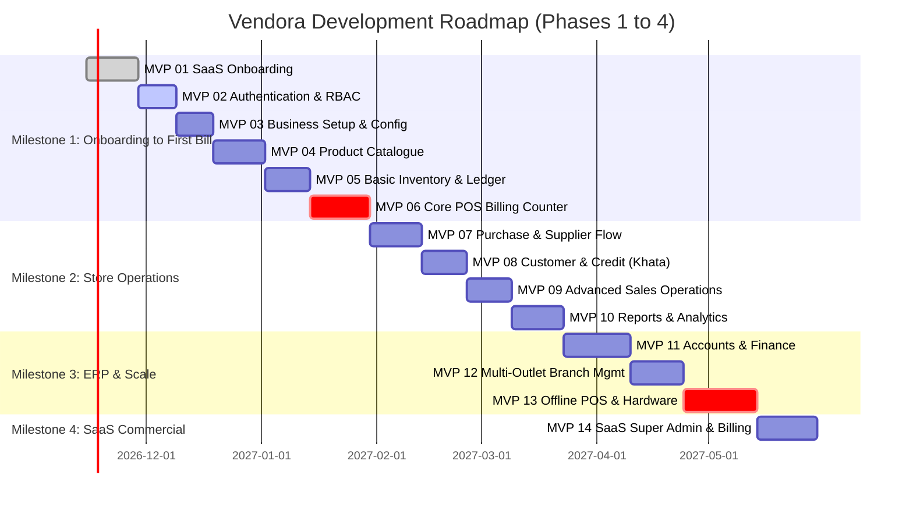

# 🗺️ Vendora – Complete MVP-Wise Development Roadmap

> **Product**: Vendora (Vend + Aura) – Cloud-Based Multi-Tenant Retail POS & ERP SaaS  
> **Tagline**: *One platform. Every retail operation.*  
> **Tech Stack**: React + TypeScript + Vite + Tailwind CSS + React Router DOM | NestJS + TypeScript | MongoDB (Mongoose)

---

## 📌 Executive Summary

Vendora is designed as a carrier-grade, multi-tenant Cloud Retail POS and ERP SaaS. Rather than attempting a monolithic release of all 117 modules simultaneously, Vendora follows a **14-phase iterative MVP roadmap**.

Each MVP is fully functional, independently testable, deployable, and brings immediate tangible business value.

```
       [MILESTONE 1: ONBOARDING TO FIRST BILL]
MVP 01 ──► MVP 02 ──► MVP 03 ──► MVP 04 ──► MVP 05 ──► MVP 06 (First Usable Retail POS)
                                                           │
       [MILESTONE 2: COMPLETE STORE OPERATIONS]             ▼
MVP 10 ◄── MVP 09 ◄── MVP 08 ◄── MVP 07 ◄──────────────────┘
  │
  ▼    [MILESTONE 3: ERP & MULTI-BRANCH SCALE]
MVP 11 ──► MVP 12 ──► MVP 13
                        │
                        ▼ [MILESTONE 4: COMMERCIAL SAAS]
                      MVP 14 (Commercial Super Admin & Metering)
```

---

## 📊 Complete MVP Release Matrix

| Release | MVP Codename | Main Focus & Key Deliverable | Modules Count | Phase Milestone |
| :--- | :--- | :--- | :---: | :--- |
| **MVP 01** | **SaaS Onboarding & Provisioning** | Plan selection, Email OTP, Auto-tenant provisioning, Welcome email | 15 Modules | Milestone 1 |
| **MVP 02** | **Authentication & RBAC** | Multi-tenant auth, Refresh tokens, Roles, Granular permissions, Security | 14 Modules | Milestone 1 |
| **MVP 03** | **Business Setup & Config** | Shop profile, Outlets, Categories, Brands, Units, GST rules, Number series | 14 Modules | Milestone 1 |
| **MVP 04** | **Product Catalogue Management** | Products, Variants, SKU/Barcodes, Pricing tiers, Bulk CSV import/export | 15 Modules | Milestone 1 |
| **MVP 05** | **Basic Inventory & Stock Ledger** | Stock movements, Double-entry stock ledger, Adjustments, Low stock alerts | 12 Modules | Milestone 1 |
| **MVP 06** | **Core POS Billing System** | Billing counter, Barcode scanner, Hold/Recall, Split pay, GST invoice, ESC/POS print | 18 Modules | **First Commercial POS** |
| **MVP 07** | **Purchase & Supplier Management** | Suppliers, Purchase Orders, Goods Receipt Note (GRN), Purchase Invoices, Payables | 13 Modules | Milestone 2 |
| **MVP 08** | **Customer Management & Credit Sales** | Customer ledger, Credit billing, Khata balance, Statements, Payment collections | 12 Modules | Milestone 2 |
| **MVP 09** | **Advanced Sales Operations** | Sales returns, Exchanges, Refunds, Quotations, Sales orders, Home delivery | 13 Modules | Milestone 2 |
| **MVP 10** | **Reports & Business Analytics** | Real-time dashboard, Daily sales, GST filing reports, Stock valuation, P&L preview | 15 Modules | Milestone 2 |
| **MVP 11** | **Accounts & Retail Finance** | Chart of accounts, Day book, Cash book, Expense tracker, Journal entries, Trial balance | 17 Modules | Milestone 3 |
| **MVP 12** | **Multi-Outlet & Branch Control** | Inter-branch stock transfers, Centralized catalog, Outlet-wise pricing & permissions | 13 Modules | Milestone 3 |
| **MVP 13** | **Advanced Retail & Offline POS** | IndexedDB offline counter, Background sync queue, Batch/Expiry, Loyalty, Hotkeys | 18 Modules | Milestone 3 |
| **MVP 14** | **SaaS Platform Administration** | Super admin console, Billing limits, Stripe/Razorpay SaaS subscriptions, Usage metering | 21 Modules | Milestone 4 |
| **TOTAL** | **Vendora Unified Cloud ERP** | **Complete Multi-Tenant Cloud Retail POS & ERP** | **117 Modules** | **Production Scale** |

---

## 🚀 Deep-Dive Breakdown: MVP 01 to MVP 14

```
================================================================================
MILESTONE 1: FROM REGISTRATION TO FIRST BILL (MVP 01 - MVP 06)
================================================================================
```

### 🔹 MVP 01 – SaaS Registration & Tenant Onboarding
**Primary Goal**: A retail merchant visits the Vendora landing page, selects a plan, verifies their email via a 6-digit OTP, fills in store profile details, and Vendora's backend autonomously provisions their isolated tenant workspace and dispatches their login credentials.

#### Included Modules (15 Modules):
1. **Subscription Plan Management (Public)**: Public catalog of plans (Free Trial, Starter, Growth, Enterprise).
2. **Business Registration Module**: Multi-step onboarding form handling store identity, owner, and tax metadata.
3. **Email OTP Verification Module**: Cryptographic 6-digit numeric OTP generation, 5-minute TTL, rate-limiting.
4. **Registration Session Management**: Redis/MongoDB backed session state machine (`EMAIL_PENDING` ➔ `EMAIL_VERIFIED` ➔ `DETAILS_PENDING` ➔ `PROVISIONING` ➔ `ACTIVE`).
5. **Tenant Management**: Creation of tenant record with unique `tenantId` and isolated subdomain routing (`shopid.vendora.com`).
6. **Tenant Provisioning Engine**: Transactional pipeline initializing tenant data space in MongoDB.
7. **Admin User Provisioning**: Automatic creation of Owner user record with salted bcrypt password.
8. **Business Type Selection**: Industry categorization (Grocery, Kirana, Supermarket, Garments, Pharmacy, Bakery, Electronics).
9. **Business Configuration Bootstrapper**: Defaults for currency (`INR`), locale (`en-IN`), timezone (`Asia/Kolkata`), date format.
10. **Default Outlet Creation**: Auto-provisions the primary "Main Branch" outlet for the new tenant.
11. **Email Template Management**: HTML email templates with dynamic brand variables.
12. **Email Notification Service**: Nodemailer / Resend / AWS SES integration for transactional email delivery.
13. **Welcome Email Engine**: Instant delivery of login URL, username, and temporary auto-generated secure credentials.
14. **Trial Management Engine**: Sets up 30-day trial window, trial expiration timestamp, and plan capability flags.
15. **Registration Status Management**: Lifecycle tracking and rollback on any provisioning step failure.

#### Deliverables & Acceptance Criteria:
- [x] Landing page with Plan comparison cards & "Start Free Trial" trigger.
- [x] Multi-step Wizard in React with React Hook Form + Zod schema validation.
- [x] Backend NestJS `OnboardingModule` with transactional rollback.
- [x] Received welcome email contains verified store URL (`https://{shopId}.vendora.com`), username, and single-use temp password.

---

### 🔹 MVP 02 – Authentication & Access Control
**Primary Goal**: High-security tenant-aware authentication, session handling, role-based access control (RBAC), and user administration.

#### Included Modules (14 Modules):
16. **Tenant-Aware Login**: Multi-tenant authentication using either subdomain context or tenant identifier.
17. **Logout & Token Invalidation**: Blacklisting tokens in Redis or revoking refresh token documents.
18. **Forgot Password Flow**: Secure password recovery via signed one-time reset token link sent to email.
19. **Reset Password Engine**: Validation of token expiry, password complexity enforcement, and re-hashing.
20. **First-Login Change Password**: Mandatory forced password rotation for auto-generated temporary passwords.
21. **JWT Refresh Token Mechanism**: Dual-token pattern (`accessToken` 15 mins, `refreshToken` 7 days) with rotation.
22. **Session Management**: Tracking active devices, IP addresses, user agents, and remote session termination.
23. **User Management**: CRUD operations for store staff, managers, and cashiers.
24. **Role Management (RBAC)**: System default roles (`Owner`, `Store Manager`, `Cashier`, `Accountant`) and custom roles.
25. **Permission Management**: Fine-grained matrix (Module + Action level: `pos:create`, `stock:adjust`, `reports:view`).
26. **Staff Management**: Assigning staff to specific store outlets with shift timings.
27. **User Activity Logs**: Audit log capturing user actions (timestamp, action, entity ID, changes).
28. **Login History Tracking**: IP tracking, failed login attempts counter, account lockout after 5 consecutive failures.
29. **Account Security Settings**: Session timeout settings, optional 2FA/MFA setup.

#### Deliverables & Acceptance Criteria:
- [x] Working `/api/v1/auth/login`, `/refresh`, `/change-password` in NestJS with Passport JWT Strategy.
- [x] React Router Protected Route wrappers with RBAC guards.
- [x] First-login forces user to change temporary password before accessing dashboard.

---

### 🔹 MVP 03 – Business Setup & Store Configuration
**Primary Goal**: Enable shop owners to configure operational parameters, master data, tax setups, and numbering rules before adding products.

#### Included Modules (14 Modules):
30. **Business Profile Settings**: Legal business name, trade name, logo upload, contact phone, support email, website.
31. **Outlet Management (Single/Primary)**: Primary branch configuration, physical address, geo-coordinates, billing phone.
32. **Department Management**: Logical store divisions (e.g., FMCG, Fresh Produce, Dairy, Beverages).
33. **Category Management**: Hierarchical categorization with slug, icon, and description.
34. **Subcategory Management**: Nested child categories under primary categories.
35. **Brand Management**: Master brand directory with brand logos and manufacturer details.
36. **Unit of Measure (UOM) Management**: Standard units (`kg`, `g`, `litre`, `ml`, `piece`, `box`, `meter`, `dozen`) with decimal precision rules.
37. **Tax & GST Configuration**: India GST engine (CGST, SGST, IGST, UTGST, Cess), HSN/SAC master directory.
38. **Invoice Configuration**: Header, footer notes, terms & conditions, QR code toggle, logo display toggle.
39. **Payment Method Configuration**: Enabled tender types (Cash, UPI, Card, Net Banking, Credit Ledger).
40. **Financial Year Configuration**: FY cycle definition (e.g., April 1 to March 31), active financial year locking.
41. **Number Series Management**: Configurable prefix, suffix, and auto-increment padding for invoices (`INV-2026-0001`), POs, and GRNs.
42. **Business General Settings**: Timezone, currency symbol placement (`₹ 100` vs `100 ₹`), rounding rules.
43. **Onboarding Checklist Wizard**: Dashboard widget showing store readiness score (Profile ➔ Tax ➔ Unit ➔ Product).

#### Deliverables & Acceptance Criteria:
- [x] Complete Business Settings UI in React with live receipt preview.
- [x] Pre-populated industry defaults based on business type chosen during MVP 01.
- [x] Document number generator service preventing race conditions using MongoDB `$inc`.

---

### 🔹 MVP 04 – Product Catalogue Management
**Primary Goal**: Empower retail owners to manage their entire product catalog with barcodes, variants, units, and bulk operations.

#### Included Modules (15 Modules):
44. **Product Management (CRUD)**: Create, edit, view, soft-delete products with standard retail attributes.
45. **Product Category & Subcategory Mapping**: Association of items with multi-level categories.
46. **Brand & Manufacturer Association**: Linking items to registered brands for reporting.
47. **Unit Assignment & Conversion**: Primary unit, secondary unit, and conversion multipliers (e.g., 1 Box = 24 Pieces).
48. **Product Variants Engine**: Matrix attributes (Size, Color, Weight, Flavor) generating discrete SKU variants.
49. **SKU Management**: Automatic or custom Stock Keeping Unit code generation.
50. **Barcode Management**: Support for EAN-13, UPC-A, Code-128 barcode generation and printable labels.
51. **Pricing Management**: Purchase Price, Wholesale Price, Base Selling Price, and Margin calculations.
52. **MRP Management**: Maximum Retail Price enforcement preventing billing above legal price caps.
53. **Product Image Management**: Multi-image upload with Cloudinary / S3 / Local storage and thumbnail generation.
54. **Product Bulk Import**: Excel (`.xlsx`) and CSV import engine with column mapping and schema validation.
55. **Product Bulk Export**: Export catalog with filtering by category, brand, and stock status.
56. **Bulk Product Update**: Batch price changes, tax rate updates, or category shifts.
57. **Industry Product Templates**: Pre-configured catalogs (e.g., 500 common Grocery items with HSN codes & standard barcodes).
58. **Product Search & Filtering Engine**: Instant regex / text indexing search by Name, SKU, Barcode, or Brand.

#### Deliverables & Acceptance Criteria:
- [x] Fast product creation screen with live profit margin calculator (`((Selling - Purchase) / Purchase) * 100`).
- [x] Barcode label printing generator (custom dimensions: 50x25mm, 38x25mm) for thermal label printers.
- [x] CSV bulk upload that validates 1,000+ items in seconds with error row highlighting.

---

### 🔹 MVP 05 – Basic Inventory & Stock Ledger
**Primary Goal**: Implement an audit-grade double-entry stock movement ledger ensuring zero stock discrepancy.

#### Included Modules (12 Modules):
59. **Opening Stock Entry**: Initial stock setup at time of onboarding with batch/rate recording.
60. **Real-Time Stock Overview**: Instant query of physical stock on hand, committed stock, and available stock per outlet.
61. **Double-Entry Stock Ledger**: Immutable log of every inventory transaction with `credit`, `debit`, and running balance.
62. **Stock In (Inward Entry)**: Manual inward for unbilled stock, owner capital additions, or returns.
63. **Stock Out (Outward Entry)**: Manual outward for samples, marketing promotions, or shrinkage.
64. **Stock Adjustment Module**: Stock reconciliation with reason codes (Damage, Theft, Expiry, Counting Error).
65. **Stock Movement History**: Comprehensive audit timeline of an item from opening entry to present day.
66. **Minimum Stock Configuration**: Defining safety stock / buffer thresholds per item.
67. **Low Stock Alert Engine**: Real-time banner and notifications when stock falls below reorder points.
68. **Stock Valuation Engine**: Valuation calculations using weighted average cost (AVCO) and FIFO methods.
69. **Damaged Stock Quarantine**: Segregation of unsellable damaged goods from sellable active inventory.
70. **Physical Stock Audit (Stocktake)**: Digital stock reconciliation sheet comparing physical count vs system balance.

#### Deliverables & Acceptance Criteria:
- [x] **Golden Rule**: Product collection does *not* rely on an isolated mutable counter; stock balance is verified by `StockLedger`.
- [x] Low stock notification center in React app header.
- [x] Stock adjustment log with mandatory manager remarks and approval audit trail.

---

### 🔹 MVP 06 – Core POS Billing System
**Primary Goal**: High-speed, resilient retail cashier checkout counter capable of 5-second customer turnaround.

#### Included Modules (18 Modules):
71. **POS Dashboard / Counter UI**: Ergonomic checkout layout optimized for touchscreens, laptops, and desktop POS terminals.
72. **Ultra-Fast Product Search**: Instant debounced search querying across 50,000 items in <50ms.
73. **Barcode Scanner Integration**: Hardware HID listener capturing barcode scans from handheld laser/2D scanners without losing input focus.
74. **Interactive Shopping Cart**: Add, increase/decrease qty, quick remove, zero-quantity guard, and price overrides (if permitted).
75. **Quantity & Unit Handling**: Decimal quantities for weigh-scale items (e.g., `1.455 kg`) and integer pieces.
76. **Item-Level Discounts**: Percentage or flat discounts on individual line items with validation caps.
77. **Bill-Level Discounts**: Global bill discounts with maximum discount authorization thresholds.
78. **Real-Time GST Calculation Engine**: Dynamic calculation of taxable amount, CGST, SGST, IGST per item based on customer state vs store state.
79. **Invoice Generation Engine**: Atomic creation of finalized immutable sales invoice with unique sequential invoice number.
80. **Cash Tender Payment**: Cash received, change calculation (`Cash Tendered - Bill Total = Change Due`).
81. **UPI Payment Integration**: Dynamic UPI QR code generation on billing screen with payable amount encoded.
82. **Card Payment Processing**: Tracking card transaction reference / auth code from external EDC machines.
83. **Split Payment Tender**: Combining Cash + UPI + Card in a single checkout transaction.
84. **Direct Thermal Receipt Printing**: Clean 2-inch (58mm) and 3-inch (80mm) ESC/POS formatted receipt layout with browser print optimization.
85. **Billing History & Search**: Instant lookup of today's bills, reprinted receipts, and customer invoice retrieval.
86. **Bill Cancellation**: Voiding an erroneous bill with manager authorization and automatic stock restoration.
87. **Cashier Shift Session**: Open drawer with opening float cash, register shift start time.
88. **Day-End Closing (Z-Report)**: Shift end cash reconciliation (Expected Cash vs Actual Cash in drawer) with variance report.

#### Deliverables & Acceptance Criteria:
- [x] Full keyboard-only operational mode (F1: Search, F2: Discount, F4: Pay, Enter: Print & New Bill).
- [x] Invoice creation commits atomically: creates invoice document, appends stock ledger debit entries, updates cashier session.
- [x] **Milestone 1 Completed**: A store owner can register, configure store, add products, adjust stock, and make live bills!

---

```
================================================================================
MILESTONE 2: COMPLETE STORE OPERATIONS (MVP 07 - MVP 10)
================================================================================
```

### 🔹 MVP 07 – Purchase & Supplier Management
**Primary Goal**: End-to-end procurement workflow from PO generation to Goods Receipt Note (GRN), invoice booking, and supplier debt management.

#### Included Modules (13 Modules):
89. **Supplier Directory & Profiles**: Vendor master with GSTIN, contact person, payment terms, and bank details.
90. **Supplier Category Management**: Categorizing vendors (Manufacturer, Wholesaler, Local Distributor).
91. **Supplier Contact Directory**: Multi-contact directory per vendor (Sales rep, Accounts manager, Delivery agent).
92. **Purchase Order (PO) Management**: Draft, approve, and send purchase orders to suppliers via email/PDF.
93. **Goods Receipt Note (GRN)**: Physical warehouse check-in recording received quantity against ordered quantity.
94. **Purchase Item Verification**: Handling discrepancies: short received, excess received, or damaged goods during transit.
95. **Purchase Invoice Booking**: Finalizing supplier tax invoice, recording invoice date, supplier invoice number, and tax credits.
96. **Automatic Stock Inwarding**: Booking a GRN automatically updates the stock ledger and recalculates cost prices.
97. **Purchase Returns (Debit Note)**: Returning expired or defective items to supplier with automatic debit note generation.
98. **Supplier Payment Recording**: Recording outgoing payments (Bank transfer, Cheque, Cash) against specific purchase bills.
99. **Supplier Outstanding Balances**: Real-time view of accounts payable per vendor with aging analysis (0-30, 31-60, 60+ days).
100. **Supplier Ledger**: Chronological transaction history of bills, payments, returns, and net closing balance.
101. **Purchase Analytics & History**: Historical purchase cost trends per item to identify supplier price escalations.

#### Deliverables & Acceptance Criteria:
- [x] Complete PO ➔ GRN ➔ Purchase Invoice flow.
- [x] Automatic cost price updates (AVCO / FIFO) upon GRN finalization.
- [x] Printable Debit Note PDF for returned goods.

---

### 🔹 MVP 08 – Customer Management & Credit Sales (Khata)
**Primary Goal**: Customer relationship management, loyalty tracking, and full credit sales (Udhar/Khata) management with collection workflows.

#### Included Modules (12 Modules):
102. **Customer Master & Profiles**: Name, mobile number, email, billing/shipping address, GSTIN (for B2B customers).
103. **Customer Grouping**: Categorizing into Retail, B2B / Wholesale, VIP, Staff.
104. **Quick Customer Creation**: Inline customer creation modal right inside the POS billing counter without leaving the cart.
105. **Customer Purchase History**: Complete itemized record of all past invoices associated with a customer.
106. **Customer Credit Facility (Khata)**: Setting customer credit eligibility and maximum credit balance limit.
107. **Credit Billing (Pay Later)**: Completing a POS invoice against customer credit account.
108. **Outstanding Payment Tracking**: Real-time dashboard of all customer receivables with overdue alerts.
109. **Customer Transaction Ledger**: Detailed statement of invoices, credit notes, payments, and net balance.
110. **Customer Payment Collection**: Recording partial or full balance payments against pending credit bills with receipt generation.
111. **Customer Account Statements**: Exportable PDF/Excel statement for WhatsApp or email dispatch to customer.
112. **Customer Import & Export**: Bulk import of legacy customer contact databases via CSV.
113. **Customer Address Directory**: Storing multiple delivery addresses per customer for home delivery orders.

#### Deliverables & Acceptance Criteria:
- [x] Seamless POS billing with "On Credit" option enabled only when credit limit permits.
- [x] WhatsApp payment reminder integration link (`https://wa.me/...`) with balance summary.
- [x] Customer statement report showing opening balance, debit bills, credit payments, and closing balance.

---

### 🔹 MVP 09 – Advanced Sales Operations
**Primary Goal**: Extend POS capabilities to handle complex real-world retail workflows including held bills, sales returns, quotations, and deliveries.

#### Included Modules (13 Modules):
114. **Hold Bills Counter**: Park incomplete shopping carts when customer forgets an item or needs time to pay.
115. **Recall Bills Counter**: Instantly restore parked carts to the active billing screen with all items and discounts intact.
116. **Sales Return Management**: Process returns against historical invoice numbers with reason tracking.
117. **Exchange Management**: Swap returned items for new items in a single counter transaction with balance adjustment.
118. **Refund Processing**: Safe refund issuance via original payment mode or store credit voucher.
119. **Sales Quotations & Estimates**: Draft non-tax estimates/quotations for B2B or institutional buyers.
120. **Quotation-to-Invoice Conversion**: One-click transformation of accepted quotation into an official tax invoice.
121. **Sales Orders (Advance Booking)**: Book future orders with advance payment collection (e.g., custom cakes, festive orders).
122. **Home Delivery Tracking**: Assign delivery orders to delivery staff with address and COD cash collection tracking.
123. **Gift Voucher Creation**: Generate unique voucher codes with cash values and expiration dates.
124. **Gift Voucher Redemption**: Redeem vouchers at checkout as tender payment with balance tracking.
125. **Sales History Filter & Audit**: Multi-attribute filtering (date range, cashier, payment method, amount range).
126. **Supervisor Approval Workflow**: Secure PIN prompt for sensitive actions (Returns, excessive discounts, void bills).

#### Deliverables & Acceptance Criteria:
- [x] Multi-tab held bills counter (up to 10 parked carts per cashier simultaneously).
- [x] Automatic inventory re-stocking upon sales return completion.
- [x] Quotation PDF generator with company branding.

---

### 🔹 MVP 10 – Reports & Business Analytics
**Primary Goal**: Provide business owners and store managers with actionable intelligence, daily summaries, and statutory tax compliance reports.

#### Included Modules (15 Modules):
127. **Executive Dashboard**: Visual KPI cards (Today's Sales, Net Profit, Bills Count, Average Bill Value, Low Stock Count).
128. **Daily Sales Performance Report**: Hourly sales trends, peak footfall hours, tender breakdown (Cash vs UPI vs Card).
129. **Monthly & Periodic Sales Report**: Comparative revenue analytics across days, weeks, and months.
130. **Product-Wise Sales Analytics**: Top 20 best-selling items, dead stock (zero sales in 60 days), high-margin items.
131. **Category & Brand Sales Report**: Sales contribution percentage by department, category, and manufacturer.
132. **Purchase Analytics Report**: Total procurement volume, supplier-wise purchase totals, price fluctuation trends.
133. **Inventory Valuation & Stock Report**: Current stock valuation at Cost price and Retail price with unrealized profit preview.
134. **Low Stock & Reorder Report**: Actionable list of items at or below reorder levels with suggested reorder quantities.
135. **Gross Profit Report**: Calculation of Gross Margin (`Sales Revenue - Cost of Goods Sold`) per bill and per item.
136. **GST Statutory Reports (GSTR-1 & GSTR-3B)**: Outward supplies summary, B2B invoices, B2CS invoices, HSN summary.
137. **Cashier Performance Report**: Total bills cut, revenue generated, discounts given, and void bills per employee.
138. **Customer Purchase Analytics**: High-value customers, frequent buyers, inactive customer lists.
139. **Supplier Transaction Summary**: Consolidated report of purchases, payments made, and current payables.
140. **Outlet Performance Report**: Revenue, margin, and transaction volume comparison across branches.
141. **Multi-Format Report Exporter**: Background streaming generation of clean PDF, Excel (`.xlsx`), and CSV reports.

#### Deliverables & Acceptance Criteria:
- [x] High-performance MongoDB aggregation pipelines with indexed date querying.
- [x] Interactive Chart.js / Recharts visualizations in React dashboard.
- [x] One-click GSTR-1 compatible Excel export.

---

```
================================================================================
MILESTONE 3: ERP & MULTI-BRANCH CAPABILITIES (MVP 11 - MVP 13)
================================================================================
```

### 🔹 MVP 11 – Accounts & Retail Finance
**Primary Goal**: Full double-entry financial accounting integrated with daily POS sales, purchases, expenses, and banking operations.

#### Included Modules (17 Modules):
142. **Chart of Accounts (COA)**: Standard tree structure (Assets, Liabilities, Equity, Revenue, Cost of Goods Sold, Expenses).
143. **Account Groups**: Logical grouping (Current Assets, Fixed Assets, Direct Expenses, Indirect Expenses).
144. **Cash Book**: Daily record of all cash receipts and cash disbursements with physical cash verification.
145. **Day Book**: Chronological record of all daily transactions across all heads of accounts.
146. **Bank Account Management**: Setup bank accounts, UPI virtual payment addresses, and credit card merchant accounts.
147. **Bank Transactions & Contra Entries**: Record cash deposits to bank (`Cash ➔ Bank`) and cash withdrawals (`Bank ➔ Cash`).
148. **Miscellaneous Income Tracker**: Record secondary revenue streams (Scrap sales, delivery fees, rental income).
149. **Expense Management**: Categorize and log store operational expenses (Rent, Electricity, Salaries, Stationery, Maintenance).
150. **Expense Receipt Attachments**: Upload photo/PDF receipts against expense entries for accounting audits.
151. **Accounts Payable (AP) Ledger**: Complete financial liability tracking for vendor procurements.
152. **Accounts Receivable (AR) Ledger**: Customer credit debt asset tracking.
153. **General Ledger (GL)**: Comprehensive account-by-account transaction ledger with opening and closing balances.
154. **Automated Journal Entries**: POS sales, purchases, and payments automatically generate balanced debit/credit journal entries.
155. **Trial Balance**: Instant verification that total Debits equal total Credits across all accounts.
156. **Profit & Loss (P&L) Statement**: Income statement showing Gross Profit, Operating Expenses, Net Operating Income, Net Profit.
157. **Balance Sheet**: Statement of financial position (Total Assets = Total Liabilities + Owner's Equity).
158. **Cash Flow Statement**: Inflow and outflow analysis across Operating, Investing, and Financing activities.

#### Deliverables & Acceptance Criteria:
- [x] Standard double-entry book-keeping where every sales bill creates a debit in Cash/Bank/AR and credit in Sales & Tax.
- [x] Interactive Profit & Loss report with drill-down capability into individual expense accounts.
- [x] Financial Year-end closing process and opening balance carry-forward.

---

### 🔹 MVP 12 – Multi-Outlet & Branch Control
**Primary Goal**: Scale Vendora to support chain stores, multi-branch supermarkets, and warehouse-to-store distribution networks.

#### Included Modules (13 Modules):
159. **Multi-Outlet Administration**: Create and configure unlimited branch outlets under a single tenant subscription.
160. **Centralized Master Catalog**: Create a product once at headquarters; make it selectively available across outlets.
161. **Outlet-Specific Pricing**: Override selling prices and promotions per branch based on local demographics.
162. **Outlet-Specific Stock Allocation**: Independent stock ledgers and balances for each individual branch.
163. **Inter-Branch Stock Transfer Request (STR)**: Branch A requests stock replenishment from Central Warehouse or Branch B.
164. **Stock Transfer Dispatch & Transit**: Warehouse approves, packs, dispatches items; stock marked as "In-Transit".
165. **Stock Transfer Receiving & Verification**: Receiving branch verifies physical quantity against transfer manifest and accepts stock.
166. **Branch-Restricted POS Terminals**: Cashiers can only view and sell inventory belonging to their assigned outlet.
167. **Outlet Staff Assignment**: Restrict staff access, shift schedules, and user permissions to specific outlets.
168. **Branch-Level Granular Permissions**: Store manager can manage their branch but cannot alter global tenant settings.
169. **Consolidated Headquarter Reports**: HQ view comparing sales, margins, and shrinkage across all outlets.
170. **Cross-Branch Stock Visibility**: Cashier at Store A can check if an out-of-stock item is available at nearby Store B.
171. **Outlet Performance Benchmarking**: Comparative leaderboards ranking branches by footfall, margin, and basket size.

#### Deliverables & Acceptance Criteria:
- [x] Outlet switcher in navigation bar for authorized multi-branch managers.
- [x] Robust Transfer Workflow: `Requested` ➔ `Approved` ➔ `Dispatched (In Transit)` ➔ `Received & Verified`.
- [x] Strict tenant-level and outlet-level filtering on all MongoDB database queries.

---

### 🔹 MVP 13 – Advanced Retail Features & Offline Capabilities
**Primary Goal**: Enterprise retail resilience, offline billing survivability, hardware integrations, batch/expiry control, and loyalty rewards.

#### Included Modules (18 Modules):
172. **Offline POS Mode**: Browser Service Worker and IndexedDB (Dexie.js) cache products, prices, and tax rules locally.
173. **Offline Billing Capability**: Cashiers can continue scanning, adding to cart, and generating bills even if Wi-Fi completely fails.
174. **Background Data Synchronization Queue**: Automatically queues offline transactions and syncs them to NestJS backend when online.
175. **Conflict Resolution Engine**: Deterministic handling of duplicate invoice sequences and inventory reconciliation during sync.
176. **Full Keyboard Shortcuts Engine**: Complete keyboard navigation (F1-F12 keys mapped to Search, Hold, Tender, Drawer, New Bill).
177. **Advanced Barcode Weight-Scale Integration**: Parsing variable-weight embedded barcodes (EAN-13 prefix 99/20: item code + weight).
178. **Batch Management**: Tracking distinct manufacturing batches for groceries, pharmaceuticals, and FMCG.
179. **Expiry Date Tracking & Alerts**: Warning cashier when attempting to scan near-expiry or expired items; pre-expiry discount rules.
180. **Serial Number & IMEI Tracking**: Unique serial tracking for electronics, smartphones, and high-value appliances with warranty records.
181. **Customer Loyalty Points Engine**: Accumulate points based on purchase value (e.g., 1 point per ₹100 spent).
182. **Loyalty Points Redemption**: One-click redemption of points as tender payment during checkout.
183. **Promotions & Campaign Engine**: "Buy 1 Get 1 Free" (BOGO), combo discounts, percentage off category on weekends.
184. **Digital Gift Cards**: Multi-use reloadable gift cards with PIN security.
185. **Automated Approval Workflows**: Manager override via PIN for refunds exceeding threshold or manual price discounts.
186. **In-App & Email Notification Engine**: Event-driven notification center (low stock, daily sales summary, new device login).
187. **Scheduled Automated Reports**: Nightly automated email dispatch of Day-End Closing report to business owner.
188. **Enterprise Audit Trail**: Comprehensive non-repudiation audit trail logging every database modification.
189. **Cloud Backup & Database Snapshots**: Automated daily cloud backups and point-in-time recovery tooling.

#### Deliverables & Acceptance Criteria:
- [x] Offline billing test: Disconnect network cable/Wi-Fi, cut 10 bills, reconnect network; all 10 bills sync seamlessly without loss.
- [x] Batch selection modal opens automatically when scanning batch-tracked items.
- [x] Fast keyboard operation: Counter operates completely mouse-free.

---

```
================================================================================
MILESTONE 4: COMMERCIAL SAAS PLATFORM (MVP 14)
================================================================================
```

### 🔹 MVP 14 – SaaS Platform Administration & Commercial Launch
**Primary Goal**: Transform Vendora from an internal ERP into a commercially scalable SaaS with automated billing, plan limits, and super-admin monitoring.

#### Included Modules (21 Modules):
190. **Super Admin Master Console**: Central administrative dashboard monitoring all active, trial, and expired tenant accounts.
191. **Tenant Lifecycle Administration**: Ability for Super Admin to inspect, impersonate (support mode), suspend, or terminate accounts.
192. **Tenant Suspension & Deactivation Engine**: Automatic tenant deactivation upon prolonged non-payment with data preservation.
193. **Subscription Plan Administration**: Dynamic creation of SaaS pricing tiers, monthly/annual pricing, and feature flags.
194. **Automated Subscription Upgrades**: In-app upgrade workflow (e.g., Starter ➔ Growth) with prorated pricing calculations.
195. **Subscription Downgrade Handler**: Graceful downgrade enforcing lower resource limits at next billing cycle.
196. **Automated Subscription Renewals**: Recurring recurring billing handling via payment webhooks.
197. **Payment Gateway Integration**: Multi-gateway support (Razorpay for India, Stripe for International) for SaaS subscriptions.
198. **Subscription Invoice Generator**: Automated generation of B2B tax invoices for SaaS subscription fees paid to Vendora.
199. **Platform Payment History**: Merchant billing history screen with downloadable tax invoices.
200. **Dunning & Failed Payment Management**: Automated email reminders and grace periods when recurring subscription charges fail.
201. **Usage Limit Management**: Hard and soft enforcement of plan parameters (Max Bills/Month, Max Staff Users, Max Outlets).
202. **Bill Limit Enforcement Engine**: Notification at 80% and 95% of plan bill quota; strict modal prompt at 100% quota.
203. **Staff User Limit Enforcement**: Preventing addition of new users beyond subscription tier entitlement.
204. **Outlet Limit Enforcement**: Restriction on creating additional branches without upgrading subscription tier.
205. **Trial Expiry Management Automation**: Automated cron job transitioning expired trials to locked state with upgrade CTA.
206. **SaaS Email Automation**: Nurture sequences (Day 3 check-in, Day 15 tips, Day 28 trial ending reminder, Day 30 expiry).
207. **Tenant Analytics & Telemetry**: Platform-wide metrics: Monthly Recurring Revenue (MRR), Churn Rate, Active Daily Cashiers.
208. **Platform Audit & Compliance Logs**: Administrative audit trail tracking super-admin actions across customer accounts.
209. **System Health & Performance Monitoring**: Real-time monitoring of API response latencies, error rates, and MongoDB health.
210. **In-App Customer Support Ticket Management**: Integrated helpdesk widget allowing merchants to submit issues and receive fixes.

#### Deliverables & Acceptance Criteria:
- [x] Super Admin portal running at `admin.vendora.com`.
- [x] Automated Razorpay/Stripe subscription checkout modal inside merchant settings.
- [x] Quota enforcement interceptor blocking bills once the Free Trial limit (1,000 bills) is exceeded.

---

## 📅 Recommended Phase-Wise Implementation Schedule



---

## 🛡️ Software Engineering & Architectural Rules

To maintain codebase integrity as Vendora expands to 117 modules:

1. **Multi-Tenancy Isolation**: Every MongoDB collection (except SaaS global plans and platform logs) MUST enforce `{ tenantId: ObjectId }` indexed at the first position.
2. **Double-Entry Stock Ledger**: Never increment or decrement an arbitrary `product.stock` counter directly. Always insert an immutable document into `stock_ledgers` within a MongoDB ACID transaction.
3. **Immutable Invoices**: Invoices are legally binding tax records. Once marked `COMPLETED`, an invoice record cannot be modified or deleted. Adjustments must happen via `sales_returns` or `credit_notes`.
4. **Offline First Contract**: Data schemas created for POS billing must be serializable and mirrorable inside browser IndexedDB for seamless syncing.
5. **Role-Based Guards**: NestJS route handlers must always feature `@UseGuards(JwtAuthGuard, TenantGuard, RolesGuard)` and `@Permissions('module:action')`.
6. **Strict Monorepo Separation**: Clear separation between `apps/web` (React client), `apps/api` (NestJS server), and `packages/shared` (TypeScript types, DTOs, interfaces).

---

*Vendora Roadmap – Version 1.0.0 – Main Document Approved.*

